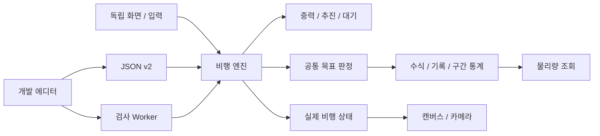

# 모듈과 물리 계약

`main.ts`가 단일 프레임 루프와 화면 전환을 소유합니다. 이전 화면은 이벤트·작업자·타이머를 정리합니다. 에디터는 DEV 조건에서만 동적으로 가져옵니다.

## 공용 상태

`Stage`는 천체·오브젝트·목표·출발 천체·규칙·성공 경로를 담습니다. 목표는 `{id,title,condition,position,startTime,endTime,dependsOn,display?}`입니다. 임무 유형 필드는 없습니다. `display`는 구형 안내 영역입니다. 새 `marker`는 그림의 경계를 공통 condition으로 컴파일하며 두 값의 일치를 검사합니다. [판정 오브젝트 계약](mission-objects.md)을 참고하세요.

`Run`은 위치·속도·명령 적용·연료·분리체·천체 상태·목표 기억을 소유합니다. 기록과 통계는 목표·참조·집합의 각 조합별로 분리되고 새 비행마다 초기화됩니다. 실행 중 소스를 변경하지 않습니다. 관측 기록을 끈 설계 검사도 같은 판정을 사용합니다.

비행 종료 직후 실제 기록의 마지막 프레임에서 자동 재생을 열고 시간을 탐색할 수 있습니다. 재생 종료로 계획에 돌아오면 바로 편집합니다. 결과 카드에 나가기 질문·재생 진입 버튼·별도 계획 편집 버튼은 없습니다. 제작 시험에만 제작 화면 복귀 버튼을 제공합니다. `playScreen`은 입장 때 스테이지를 복제하고 계획·비행·관측·남은 시도를 화면 안에 소유합니다. `App`에는 설정과 완료 ID만 공유하며, 임무 간 물리 상태나 자원은 전달하지 않습니다. 배속 선택만 모든 비행·훈련에서 같은 브라우저 저장 키를 사용합니다.

`RoutePlan`에 첫 추진·예약 수정 추진·엔진 명령을 저장합니다. 발사 순간 복사본으로 확정합니다. 비행 중 편집하지 않습니다. Trial은 당시 전체 예약, 실행 ID, 복사할 실행 계획, 실제 프레임을 별도로 보관합니다. 재생은 녹화 상태를 읽으며 엔진을 다시 실행하지 않습니다.

## 물리

오른쪽 +X, 위 +Y, 거리 u, 시간 t입니다. 최대 물리 간격은 0.01t이고 명령 시각에서 분할합니다. RK4로 적분합니다. 화면 크기·카메라는 판정에 사용하지 않습니다.

- 고정·지정 원형 공전 천체는 외부 중력장을 제공합니다. 상호 중력을 켠 천체는 서로의 중력을 동시에 적분합니다.
- 로켓의 중력 적분은 시험 질점 모델이며 거대 천체에 대한 반작용을 무시합니다. 접촉은 전체 동체 캡슐로 판정합니다. 물리 위치는 로켓 바닥이고 그림은 그 앞에 그립니다. 표면 출발은 천체·각도·반지름에서 위치·속도를 계산하고, 자유 공간 출발은 spawn의 위치·속도를 그대로 사용합니다. spawn.placed:false는 미배치 초안으로 실행/공개가 거절되며 기체도 그리지 않습니다. 에디터 변경·비행 생성은 동일한 출발 계약을 사용합니다. 다단 로켓은 이륙 전 발사대가 지지하지만 연료는 소모하며, 이륙 후 지면 충돌을 정상 판정합니다.
- 기본 모델은 예산이 유한한 즉시 Δv입니다. 연료 모델은 질량 감소·로켓 방정식·추력·배기 속력·재점화 한도를 적용합니다.
- 분리체는 원래 바닥에 남고 위 로켓은 한 단 길이만큼 앞에 배치해 끝 위치를 이어갑니다. 분리 스프링의 작은 상대 속도는 질량비로 나누어 총 운동량을 보존합니다. 다음 엔진은 자동 점화하지 않습니다. 분리체를 대상으로도 사전 엔진 명령을 예약합니다.
- 지수형 대기·상대 공기 속도·항력·동압·가열은 게임용 근사입니다.
- 충돌은 이동 캡슐과 움직이는 원의 연속 교차입니다. 코끝·옆면·고속 통과를 검사하며 몸체 전체를 표면 밖으로 정렬합니다. 그림과 판정은 world/hull.ts의 세계 좌표 치수를 공유합니다. 단 수가 줄면 두 크기가 함께 줄어듭니다. 주 로켓은 반동을 보여 준 뒤 실패합니다. 안전한 접촉은 정착 상태로 유지할 수 있습니다.
- 블랙홀 경계 안의 탐사체는 복귀할 수 없습니다. 일반상대론을 사용하지 않습니다.

## 화면과 제작

모든 구버전·새 스테이지는 같은 관제석·시간선·조작 팝업을 사용합니다. 스테이지별로 옛 조준 UI를 선택하지 않습니다. 최초 추진도 계획 창의 장치 제어로 편집하며, 지도 드래그는 카메라 이동입니다. 패널 입력은 카메라가 가로채지 않습니다. 좌표 변환에는 CSS 크기를 사용하고 화면 픽셀 밀도는 렌더링에만 적용합니다. 훈련의 강조·설명만 별도이며 풀이 절차는 본편에 제공하지 않습니다.

각 화면은 `Screen`의 `frame`/`dispose`만 제공합니다. 도움말·설정은 비행 엔진 없이 독립 수정할 수 있습니다. 공통 상태만 `App`으로 전달합니다.

에디터는 시험 화면에 성공 경로 저장 및 개발 관찰 콜백을 넘깁니다. 관찰창은 판정 기억의 복사본을 읽어 실제 통계에 영향을 주지 않습니다. 일반 캠페인에는 이 콜백이 없습니다.

undo/redo는 선택 상태도 저장합니다. UUID 복제는 대상·비행체·선행 참조를 바꿉니다. 변경 후 이전 검사 Worker를 종료하고 새 스냅샷을 검사합니다. 저장 API는 공통 StageStorage로 파일의 원자 교체 또는 PostgreSQL 트랜잭션을 수행하며 revision을 다시 확인합니다. 제작 비밀 키는 서버 환경 변수와 편집 탭 메모리에만 보관합니다. [무료 운영·이전 계약](free-hosting.md)을 참고합니다.

## 재시도와 충돌 연출

`world/evidence.ts`는 제작자가 정의한 관측 수식·측정 조건·상황 단서를 실제 물리 스텝에서 수집합니다. 목표의 메모리와 독립적입니다. `Run`에는 현재 비행 관측을, 플레이 화면에는 이 스테이지의 완료 실험 목록을 보관합니다. 실제로 적용한 명령만 실험 카드에 복사하며 반복 실험은 동일한 초기 조건을 사용합니다. 연료·분리체 상태는 매번 새로 생성하므로 이전 비행이 물리적으로 다음 로켓에 기여하지 않습니다. 새 도전에서 횟수를 회복해도 누적 기록은 유지합니다.

`editor/learning-inspector.ts`가 단서 제작 UI를 제공합니다. 기존 목표의 공통 블록과 같은 언어를 사용하며 판정값을 플레이어에게 노출하지 않습니다. 기존 variation/dimensions/randomization 모듈은 선택적인 제작 연구로 남고 런타임 재시도에 사용하지 않습니다. [진행·제작 계약](puzzle-loop.md)을 참고합니다.

`impact.ts`는 충돌 순간 자세를 보관하고 한 번의 감쇠 반동 후 실패로 전이합니다. 반동 중 속도 부호를 자세로 다시 변환하거나 지면 충돌을 반복 계산하지 않습니다. 화면 프레임에서 정상 비행과 충돌 연출은 한 번만 갱신합니다.

비행 계획 UI는 screens/flight/timeline.ts, 장치 출력·연료 안내는 world/program.ts, 기록 재생은 world/replay.ts, 로켓 아트는 render/rocket-sprite.ts에 있습니다. 담당을 나누어 수정할 수 있으며 크기 변경은 hull 계약을 함께 리뷰합니다. [상세 계약](flight-program.md)을 참고합니다.

화면 스타일은 flight/, tutorial/, settings/와 editor/가 각각 소유합니다. style.css는 공유 기본 요소만 보관합니다. check:boundaries로 tutorial/settings의 역할 간 의존성, 모델의 UI 의존성을 검사합니다.

무제한 시간은 rules.maxTimeUnlimited / timelineUnlimited로 저장합니다. 초기 표시 길이는 유한합니다. missionTimeLimit/planningTimeLimit이 런타임 상한을 계산하고, execute는 별도 audit.timeLimit(기본 maxTime)에서 유한하게 종료합니다. Goal.endTimeUnlimited로 목표별 시간 창도 독립적으로 선택합니다.
